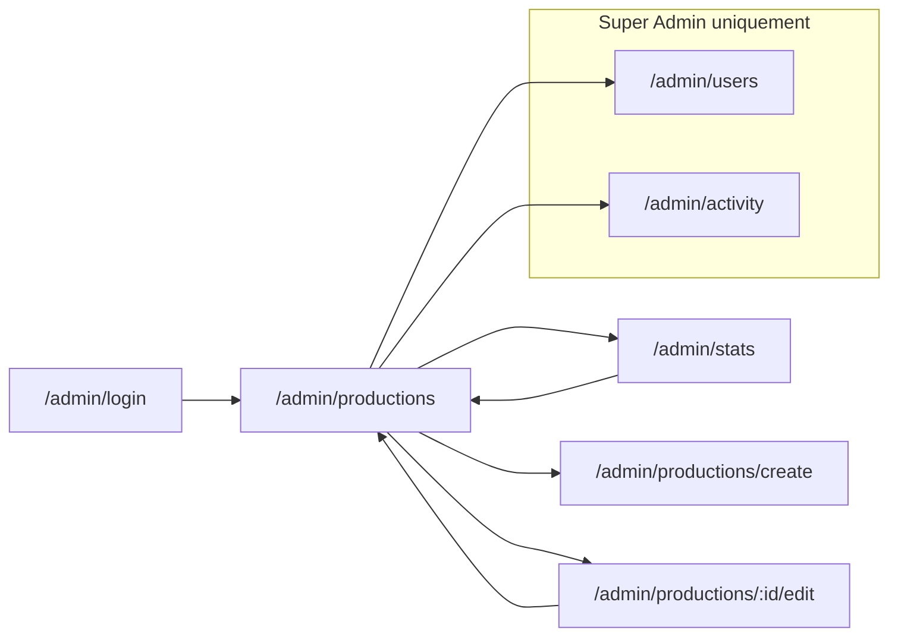
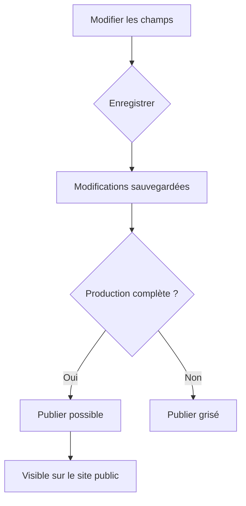

# Guide administrateur Anta

Ce guide s'adresse aux **administrateurs** qui utilisent le panel admin pour enregistrer, modifier et publier des productions sur le site public Anta.

> **Pressé ?** Version condensée : [Quick Start](guide-admin-quickstart.md) — export PDF : `python scripts/md_to_pdf.py`

### Parcours rapide (créer et publier une production)

> Guide dédié : [Quick Start](guide-admin-quickstart.md) · PDF : `python scripts/md_to_pdf.py _docs/guide-admin-quickstart.md`

1. **Productions** → **Créer une production**
2. Remplissez au minimum le **titre**, puis **Enregistrer brouillon**
3. Complétez tous les champs jusqu'au bandeau **vert** en haut du formulaire
4. Ajoutez au moins **un fichier** ou **un lien** (selon la licence)
5. Cliquez **Publier** — la production apparaît sur le site public

---

## 1. Avant de commencer

### Prérequis

| Élément | Détail |
|--------|--------|
| **Appareil** | **Ordinateur de bureau** (écran ≥ 1024 px). Sur mobile ou tablette, le panel affiche un message invitant à utiliser un ordinateur. |
| **Navigateur** | Navigateur récent (Chrome, Firefox, Edge, Safari). |
| **Accès** | Compte administrateur créé par un **Super Admin**. |
| **URL de connexion** | `/admin/login` (ex. `https://votre-site.example/admin/login`) |

### Rôles

Deux niveaux d'accès existent :

| Rôle | Badge sidebar | Accès |
|------|---------------|-------|
| **Admin** | Admin | Productions, statistiques |
| **Super Admin** | Super Admin (vert) | Tout ce qu'un Admin peut faire **+** gestion des comptes administrateurs **+** journal d'activité |

Si vous tentez d'ouvrir une section réservée (Utilisateurs, Activité) sans être Super Admin, vous êtes redirigé vers la liste des productions avec le message *« Accès refusé »*.

---

## 2. Première connexion

### Étape 1 — Recevoir vos identifiants

Un Super Admin crée votre compte avec votre **adresse email**. Vous recevez alors :

- un **email d'invitation** contenant un mot de passe provisoire, **ou**
- le mot de passe provisoire transmis manuellement si l'email n'a pas pu être envoyé.

### Étape 2 — Se connecter

1. Ouvrez `/admin/login`.
2. Saisissez votre **email** et le **mot de passe provisoire**.
3. Cliquez pour vous connecter.

**Messages possibles :**

| Message | Signification |
|---------|---------------|
| *Email ou mot de passe incorrect* | Identifiants invalides |
| *Ce compte est désactivé* | Votre compte a été désactivé — contactez un Super Admin |

### Étape 3 — Définir votre mot de passe permanent

À la **première connexion**, vous êtes redirigé automatiquement vers la page de changement de mot de passe. Tant que cette étape n'est pas faite, vous ne pouvez pas accéder au reste du panel.

1. Saisissez un **nouveau mot de passe** (minimum **12 caractères**).
2. **Confirmez** le mot de passe (identique au précédent).
3. Validez.

Vous arrivez ensuite sur la **liste des productions** (`/admin/productions`).

---

## 3. Navigation dans le panel

| Section (menu gauche) | URL | Description |
|----------------------|-----|-------------|
| **Productions** | `/admin/productions` | Liste, recherche, création, modification |
| **Statistiques** | `/admin/stats` | Vue d'ensemble des vues et téléchargements |
| **Utilisateurs** | `/admin/users` | Gestion des comptes admin *(Super Admin)* |
| **Activité** | `/admin/activity` | Journal des actions admin *(Super Admin)* |
| **Se déconnecter** | — | Fin de session, retour à la page de connexion |

---

## 4. Comprendre les statuts d'une production

| Statut affiché | Signification |
|----------------|---------------|
| **Brouillon** | Enregistrée mais **non visible** sur le site public. C'est l'état par défaut à la création, et l'état après une **dépublication**. |
| **Publié** | **Visible** sur le site public (recherche, filtres, page détail). |

Le filtre **Dépublié** peut encore apparaître dans la liste pour d'anciennes données ; en pratique, lorsque vous **dépubliez** une production, elle repasse en **brouillon**. Pour retrouver une production retirée du site, filtrez par **Brouillon**.

**Dépublier** une production la repasse en **brouillon** — elle disparaît du site public mais reste modifiable dans le panel. Pour la remettre en ligne : complétez à nouveau le formulaire (bandeau vert) et cliquez **Publier**.

> **Attention :** si une production **publiée** devient **incomplète** (champ obligatoire vidé, fichier ou lien supprimé), elle est **automatiquement dépubliée** à l'enregistrement. Un message vous en informe.

---

## 5. Gérer les productions

### 5.1 Liste et recherche

1. Ouvrez **Productions** dans le menu.
2. Utilisez la **barre de recherche** pour trouver une production par titre, auteur, etc.
3. Filtrez par **statut**, **catégorie**, **domaine** ou **langue** si besoin.
4. La liste affiche **20 productions par page** — utilisez la pagination en bas.

**Actions sur chaque ligne :**

| Action | Effet |
|--------|-------|
| **Modifier** | Ouvre le formulaire d'édition |
| **Dépublier** | Visible uniquement si la production est publiée → repasse en brouillon |
| **Supprimer** | Suppression **définitive** (production + fichiers hébergés) — demande une confirmation |

### 5.2 Créer une production (pas à pas)

1. Cliquez **Créer une production**.
2. Remplissez le formulaire (voir [§ 6](#6-le-formulaire-de-production)).
3. Pour un premier enregistrement rapide, seul le **titre** est obligatoire.
4. Cliquez **Enregistrer brouillon**.
   - La production est créée en statut **brouillon**.
   - Vous êtes redirigé vers la **page d'édition**.
   - Les **fichiers** et **liens** ajoutés en « En attente » sont envoyés automatiquement après cette première sauvegarde.
5. Complétez les champs restants jusqu'à ce que l'**indicateur de complétion** (bandeau en haut) passe au **vert**.
6. Cliquez **Publier** pour rendre la production visible sur le site public.

**Publication directe à la création :** si tous les champs requis sont remplis **et** qu'au moins un fichier ou lien satisfait la règle de licence (voir [§ 7](#7-fichiers-et-liens)), le bouton **Publier** est disponible dès la page de création. Il enregistre, envoie les pièces jointes en attente, puis publie en une seule action.

### 5.3 Modifier une production

1. Depuis la liste, cliquez **Modifier** sur la ligne souhaitée.
2. Modifiez les champs nécessaires.
3. Cliquez **Enregistrer** (ou **Enregistrer brouillon** selon le contexte).

**Règle importante — Enregistrer avant Publier :**

Sur la page d'édition, **Publier** et **Enregistrer** sont deux actions **distinctes**. Si vous modifiez le formulaire puis cliquez **Publier** sans avoir cliqué **Enregistrer** avant, vos dernières modifications **ne seront pas prises en compte** à la publication.

### 5.4 Publier

**Conditions pour publier :**

- Tous les **champs obligatoires** remplis (voir [Annexe A](#annexe-a--champs-obligatoires-pour-publier)).
- Règle **fichiers / liens** respectée selon le statut de licence (voir [§ 7.3](#73-règle-de-publication-selon-la-licence)).
- L'**indicateur de complétion** est vert.

Si **Publier** est grisé, cliquez sur l'indicateur orange : il liste les champs manquants (liens cliquables vers chaque section).

### 5.5 Dépublier

**Depuis la liste :**

1. Sur une production **publiée**, cliquez **Dépublier**.
2. Confirmez dans la fenêtre : *« La production ne sera plus visible sur le site public. Elle repassera en brouillon. »*
3. La production repasse en **brouillon**.

**Depuis la page d'édition :**

1. Cliquez **Dépublier** — l'action est **immédiate** (pas de seconde confirmation).
2. La production repasse en **brouillon**.

### 5.6 Supprimer

1. Depuis la **liste**, cliquez **Supprimer**.
2. Confirmez — l'action est **irréversible**.
3. La production et ses **fichiers hébergés** (PDF, vidéo, etc.) sont supprimés.

---

## 6. Le formulaire de production

Le formulaire est organisé en **5 sections** :

| Section | Contenu principal |
|---------|-------------------|
| **Informations générales** | Titre, auteur(s), catégorie, domaine, sous-domaine(s), langue, pays |
| **Contenu** | Résumé, tags, date de publication de l'œuvre |
| **Droits & Licence** | Statut de licence (Production membre / Licence libre / Lien externe copyright) |
| **Informations complémentaires** | Journal, éditeur, ISBN/DOI/ISSN, institution *(optionnels)* |
| **Fichiers & Liens** | Upload de fichiers et liens externes |

### Taxonomies (catégorie, domaine, sous-domaine)

- **Catégorie** et **domaine** : listes prédéfinies (menus déroulants). Vous ne pouvez pas saisir de texte libre.
- **Sous-domaine** : apparaît après avoir choisi un **domaine**. Sélectionnez une ou plusieurs valeurs autorisées pour ce domaine (chips ou boutons rapides).
- Si vous **changez de domaine**, les sous-domaines qui ne correspondent plus au nouveau domaine sont **retirés automatiquement**.

Les libellés affichés sont en français dans le panel ; les valeurs stockées suivent une taxonomie fixe (livre, article, vidéo, mathématiques, informatique, etc.).

### Saisie des auteurs, tags et sous-domaines

Ces champs utilisent des **pastilles** (chips) :

1. Tapez une valeur (ex. un nom d'auteur).
2. Appuyez sur **Entrée** ou tapez une **virgule** pour l'ajouter.
3. Répétez pour ajouter d'autres valeurs.
4. Cliquez sur **×** sur une pastille pour la retirer.

Pour les **sous-domaines**, des suggestions apparaissent selon le **domaine** choisi ; vous pouvez aussi utiliser les boutons rapides proposés.

### Indicateur de complétion

Bandeau **fixe en haut** du formulaire :

| Couleur | Signification |
|---------|---------------|
| **Orange** | Texte du type *« X/Y champs — Z requis pour publier »* — cliquez sur les liens pour accéder directement aux champs manquants |
| **Vert** | *« Tous les champs requis sont remplis »* — publication possible (sous réserve de la règle fichiers/liens) |

---

## 7. Fichiers et liens

### 7.1 Upload de fichiers

**Contraintes :**

| Règle | Valeur |
|-------|--------|
| Taille maximale | **100 Mo** par fichier |
| Formats acceptés | **PDF**, **EPUB**, **MP4**, **MP3**, **AAC** |
| Nombre à la fois | **Un seul fichier** par envoi |

**Procédure — page d'édition (production déjà enregistrée) :**

1. Allez à la section **Fichiers & Liens**.
2. **Glissez-déposez** un fichier dans la zone prévue, ou cliquez **Parcourir**.
3. Attendez la fin de l'envoi (barre de progression).
4. Le fichier apparaît dans la liste. Message de succès : *« Fichier ajouté. »*

**Procédure — page de création (avant première sauvegarde) :**

1. Ajoutez le fichier — il apparaît avec le statut **« En attente »**.
2. Cliquez **Enregistrer brouillon** : la production est créée, puis les fichiers en attente sont envoyés automatiquement.

> **Note :** les **liens externes** ajoutés avant la première sauvegarde suivent le même comportement (statut « En attente », envoi après **Enregistrer brouillon**).

**Supprimer un fichier :** bouton **Supprimer** à côté du fichier dans la liste (page d'édition).

**Messages d'erreur courants :**

| Message | Cause | Action |
|---------|-------|--------|
| *Fichier trop volumineux. Maximum 100 Mo.* | Fichier > 100 Mo | Réduire la taille ou utiliser un **lien externe** |
| *Format non supporté…* | Extension ou type non autorisé | Convertir au format accepté ou lien externe |
| *Un seul fichier à la fois.* | Plusieurs fichiers déposés ensemble | Envoyer les fichiers un par un |
| *Fichier invalide ou format non autorisé.* | Le contenu réel ne correspond pas au format déclaré | Vérifier l'intégrité du fichier |

### 7.2 Liens externes

1. Dans **Fichiers & Liens**, cliquez **Ajouter un lien**.
2. Saisissez l'**URL** (doit commencer par `http://` ou `https://`).
3. Choisissez le **type** :
   - **Lien simple** — renvoie vers une page externe (PDF hébergé ailleurs, site éditeur, etc.).
   - **Embed** — contenu intégré (ex. vidéo YouTube) sur la page publique de la production.
4. **Libellé** *(optionnel)* — texte affiché à la place de l'URL brute.
5. Validez l'ajout du lien.

> **Astuce :** appuyer sur **Entrée** dans un champ de lien **ajoute le lien** ; cela **n'enregistre pas** la production entière. Pensez à cliquer **Enregistrer** après vos modifications.

### 7.3 Règle de publication selon la licence

| Statut de licence | Pour publier, il faut au minimum… |
|-------------------|-----------------------------------|
| **Production membre** ou **Licence libre** | **Un fichier hébergé** *ou* **un lien externe** |
| **Lien externe (copyright)** | **Au moins un lien externe** — un fichier seul **ne suffit pas** |

Cas typique « copyright » : l'œuvre est protégée et hébergée chez l'éditeur → ajoutez le lien vers la ressource, sélectionnez *Lien externe (copyright)*, puis publiez.

---

## 8. Statistiques

### Vue globale (`/admin/stats`)

Accessible à **tous les administrateurs** :

- Nombre de productions publiées
- **Vues** et **téléchargements** totaux
- **Top 10** des productions les plus consultées / téléchargées
- Tableau d'**évolution sur 30 jours**

Cliquez sur un titre pour ouvrir la page publique correspondante.

### Statistiques par production

Sur la **page d'édition** d'une production, un bloc affiche :

- Vues et téléchargements
- Dates de première publication et dernière modification
- Graphique des vues sur **30 jours**

Si la production n'a pas encore été consultée, un message indique l'absence de données.

---

## 9. Gestion des comptes *(Super Admin)*

### Créer un administrateur

1. **Utilisateurs** → **Créer un administrateur**.
2. Saisissez l'**adresse email**.
3. Cliquez **Créer le compte**.
4. Un mot de passe provisoire est généré et un **email d'invitation** est envoyé.

Si l'email échoue, un message de succès partiel s'affiche avec le **mot de passe provisoire** dans une notification persistante — transmettez-le manuellement au nouvel admin.

### Actions sur un compte

| Action | Effet |
|--------|-------|
| **Désactiver** | L'utilisateur ne peut plus se connecter ; ses productions restent |
| **Réactiver** | Rétablit l'accès |
| **Réinitialiser le mot de passe** | Nouveau mot de passe provisoire par email ; l'utilisateur devra le changer à la prochaine connexion ; ses sessions actives sont fermées |
| **Supprimer** | Suppression du compte et de ses logs ; **les productions qu'il a créées sont conservées** |

**Limites :**

- Vous ne pouvez pas désactiver, réinitialiser ou supprimer **votre propre compte**.
- Les actions de gestion ne s'appliquent pas aux comptes **Super Admin**.

---

## 10. Journal d'activité *(Super Admin)*

**Activité** (`/admin/activity`) liste les actions des administrateurs :

| Type d'action | Exemple |
|---------------|---------|
| Connexion | Login réussi |
| Création / Modification | Production créée ou mise à jour |
| Publication / Dépublication | Changement de visibilité publique |
| Suppression | Production ou compte supprimé |
| Réinit. mot de passe | Mot de passe provisoire généré |

Filtrez par **administrateur** ou **type d'action**. Liste paginée (20 entrées par page), plus récent en haut. Lecture seule.

---

## 11. Dépannage (FAQ)

| Problème | Solution |
|----------|----------|
| **Publier** est grisé | Complétez les champs listés dans l'indicateur orange ; vérifiez fichiers/liens selon la licence |
| Mes modifications ne sont pas publiées | Cliquez **Enregistrer** avant **Publier** (page d'édition) |
| Upload bloqué ou erreur « Request entity too large » | Fichier > 100 Mo — utilisez un lien externe ou compressez le fichier |
| « Format non supporté » | Vérifiez PDF, EPUB, MP4, MP3 ou AAC uniquement |
| Production publiée disparue du site | Vérifiez si elle a été dépubliée ou rendue incomplète (auto-dépublication) |
| « Ce compte est désactivé » | Contactez un Super Admin pour réactivation |
| Déconnecté après reset mot de passe | Normal — reconnectez-vous avec le mot de passe provisoire |
| Panel illisible sur téléphone | Utilisez un ordinateur (largeur ≥ 1024 px) |
| Fichiers « En attente » en création | Cliquez **Enregistrer brouillon** pour déclencher l'envoi (fichiers **et** liens en attente) |

---

## Annexe A — Champs obligatoires pour publier

Pour passer l'indicateur au vert et publier, tous les champs suivants doivent être remplis :

**Informations générales :** Titre, Auteur(s), Catégorie, Domaine, Sous-domaine (au moins un), Langue, Pays de publication

**Contenu :** Résumé, Tags (au moins un), Date de publication de l'œuvre

**Droits & Licence :** Statut de licence

**Fichiers & Liens :** Selon la licence (voir [§ 7.3](#73-règle-de-publication-selon-la-licence))

Les champs de la section *Informations complémentaires* restent **optionnels**.

---

## Annexe B — Catégories disponibles

Livre · Article · Vidéo · Musique · Podcast · Thèse · Rapport · Mémoire · Note · Actes de conférence · Document de travail

*(Libellés exacts affichés en français dans le menu déroulant.)*

---

## Annexe C — Messages de confirmation courants

| Action | Message |
|--------|---------|
| Brouillon enregistré | *Brouillon enregistré.* |
| Modifications sauvegardées | *Modifications enregistrées.* |
| Publication | *Production publiée.* |
| Dépublication | *Production dépubliée.* |
| Suppression | *Production supprimée.* |
| Fichier ajouté / supprimé | *Fichier ajouté.* / *Fichier supprimé.* |
| Lien ajouté / supprimé | *Lien ajouté.* / *Lien supprimé.* |
| Déconnexion | *Vous êtes déconnecté.* |

Les messages de **succès** disparaissent après quelques secondes. Les messages d'**erreur** restent affichés jusqu'à ce que vous les fermiez.

---

*Dernière mise à jour : juillet 2026 — aligné sur le panel admin Anta (formulaire unifié, taxonomies prédéfinies, limite upload 100 Mo).*
