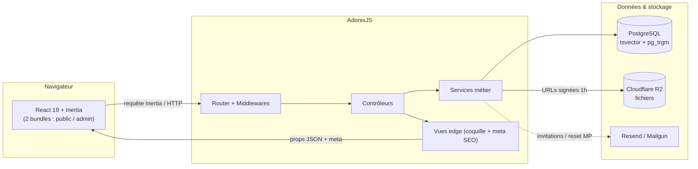
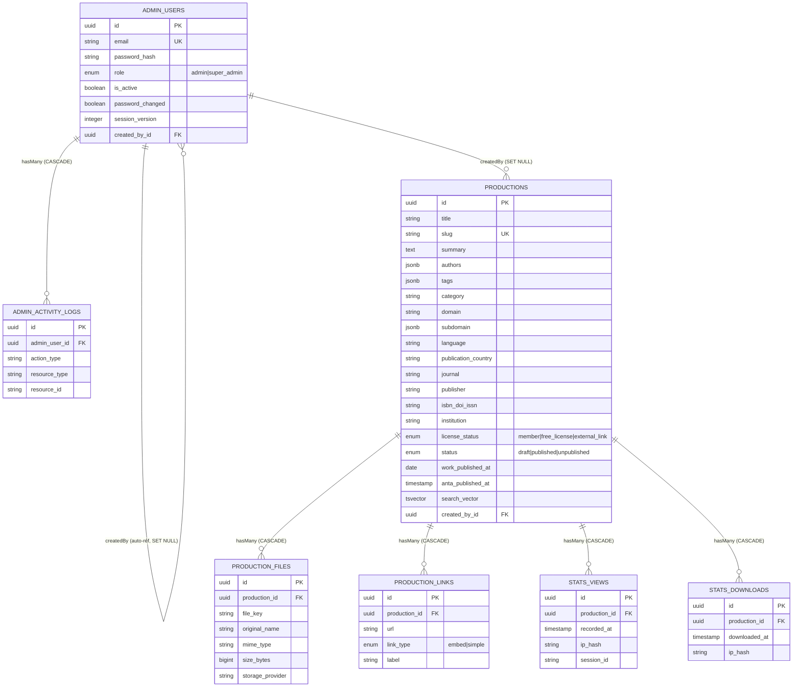
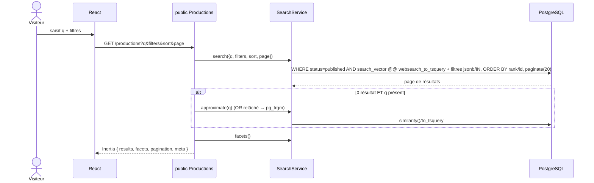
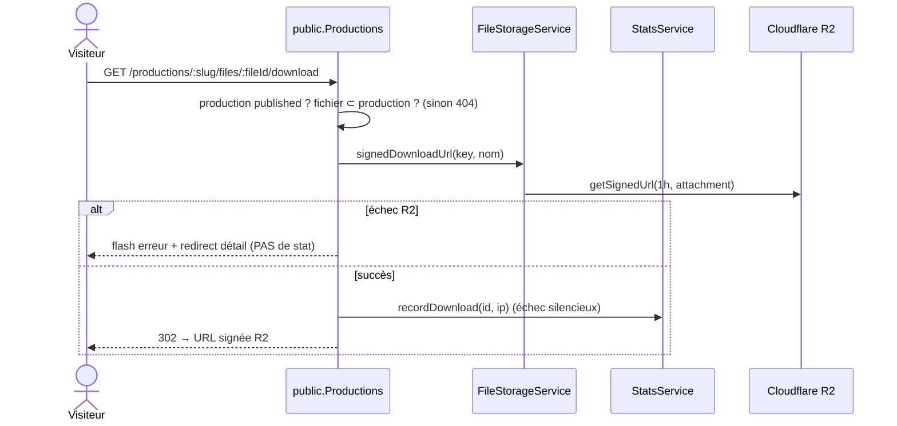
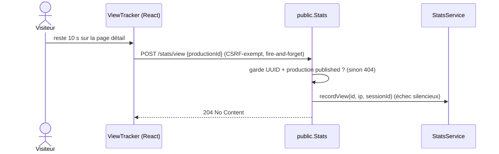
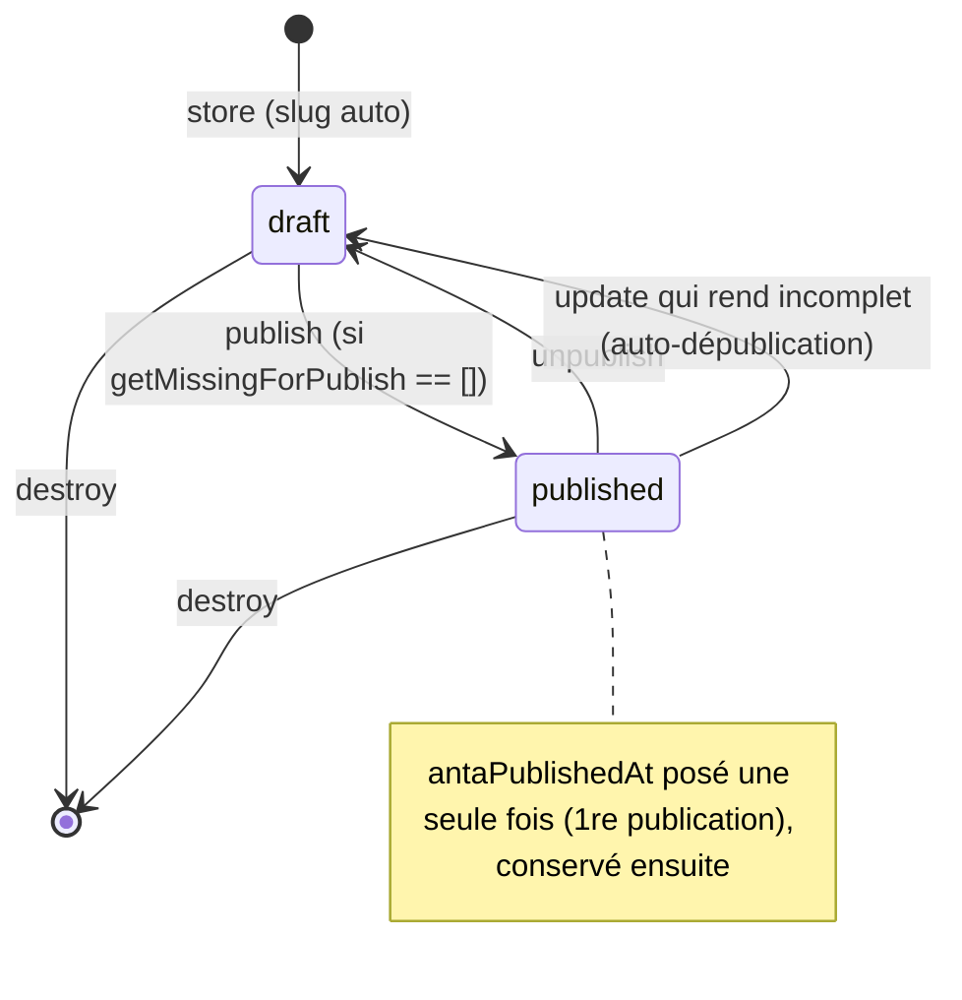

# Anta — Architecture technique (as-built)

> **Statut :** Référence de maintenance — décrit le système **tel qu'implémenté** (Epics 1 → 7).
> **Audience :** développeurs (maintenance, évolution, reprise).
> **Complément de** `_bmad-output/planning-artifacts/architecture.md` (la planification, parfois aspirationnelle). En cas de divergence, **ce document fait foi** — il reflète le code réel.
> **Dernière mise à jour :** 2026-06-02.

---

## 1. Vue d'ensemble

Anta est la **bibliothèque numérique de la communauté ETE** : un site public de découverte/consultation de productions académiques + un panneau d'administration pour les gérer.

| Couche | Technologie | Version |
|---|---|---|
| Runtime / framework | AdonisJS (Core) | 7.x |
| ORM | Lucid + PostgreSQL (driver `pg`) | 22.x |
| Pont serveur ↔ client | Inertia.js (adapter AdonisJS) — **`ssr: false`** | 4.x |
| UI | React | 19.x |
| Styling | Tailwind CSS v4 + shadcn/ui (Radix + CVA) | 4.x |
| i18n | react-i18next (FR/EN) | 17.x |
| Stockage fichiers | Cloudflare R2 via `@adonisjs/drive` (API S3) | 4.x |
| Email | `@adonisjs/mail` (Resend / Mailgun) | 10.x |
| Auth / sécurité | `@adonisjs/auth` (guard session) + `@adonisjs/shield` (CSRF/HSTS) | 10.x / 9.x |
| Type-safety routes | Tuyau (`@tuyau/core`) | 1.x |
| Build | Vite | 7.x |

**Principe d'architecture clé :** le HTML est rendu **côté client** (`ssr: false`). Le serveur ne rend que la coquille edge + les **meta SEO** (SSR partiel, FR36). Conséquence transversale : tout ce qui doit être visible des crawlers (titre, meta, og:*) passe par une **prop Inertia `meta`** injectée dans la vue edge ; le reste est rendu par React après hydratation.



---

## 2. Modèle de données

### 2.1 Diagramme entité-relation



### 2.2 Conventions de schéma

- **Clés primaires** UUID (`gen_random_uuid()`) partout.
- **Horodatage** : `created_at` (auto), `updated_at` (nullable, auto-update).
- **Intégrité** : `ON DELETE CASCADE` pour les données dépendantes (fichiers, liens, stats, logs) ; `ON DELETE SET NULL` pour les liens de propriété (`created_by_id`).
- **Enums** : types natifs PostgreSQL (créés/détruits explicitement dans les migrations).

### 2.3 Colonnes & mécanismes spéciaux

| Élément | Détail |
|---|---|
| `productions.search_vector` (tsvector) | Recalculé par le **trigger** `productions_search_vector_trigger` (BEFORE INSERT/UPDATE) → fonction `productions_search_vector_update()` qui concatène `title, summary, authors::text, tags::text, category, domain, subdomain::text, language` via `to_tsvector('simple', …)`. Index **GIN**. |
| `productions.slug` | `varchar(255)` **UNIQUE NOT NULL**. Généré au **hook `@beforeCreate`** du modèle (`ProductionService.generateUniqueSlug`) : translittération ASCII, minuscules, non-alphanumériques → `-`, max ~80 car., suffixe `-2/-3…` anti-collision. **Jamais modifié** après création (URLs stables). |
| `authors`, `tags`, `subdomain` (jsonb) | Tableaux de chaînes (`prepare`/`consume` JSON dans le modèle). Filtrage par containment `@>`. |
| `work_published_at` (date) vs `anta_published_at` (timestamp) | Date de publication **de l'œuvre** vs date de **première mise en ligne sur Anta** (cette dernière n'est posée **qu'une fois**, conservée après dépublication — FR35). |
| `pg_trgm` (extension) | Index GIN **trigram** sur `productions.title` → recherche approximative (orthographique). |
| `session_version` (admin_users) | Incrémenté à la réinitialisation de mot de passe → invalide les sessions actives (cf. §7.1). |

### 2.4 Enums

| Enum | Valeurs |
|---|---|
| `ProductionStatus` | `draft`, `published`, `unpublished` |
| `LicenseStatus` | `member`, `free_license`, `external_link` |
| `AdminRole` | `admin`, `super_admin` |
| `ActionType` | `login`, `create`, `update`, `publish`, `unpublish`, `delete`, `password_reset` |
| `LinkType` | `embed`, `simple` |

### 2.5 Migrations (ordre chronologique)

| Timestamp | Migration | Effet |
|---|---|---|
| …726313 | `create_admin_users_table` | Table `admin_users` (avec colonnes TOTP initiales) |
| …733547 | `create_productions_table` | Table `productions` + enums + trigger `search_vector` + index GIN |
| …734339 | `create_production_files_table` | Table `production_files` (FK CASCADE) |
| …735161 | `create_production_links_table` | Table `production_links` (FK CASCADE) |
| …736010 | `create_stats_views_table` | Table `stats_views` (+ index `production_id`, `recorded_at`) |
| …736820 | `create_stats_downloads_table` | Table `stats_downloads` (+ index `production_id`) |
| …737632 | `create_admin_activity_logs_table` | Table `admin_activity_logs` (+ index) |
| …740000 | `drop_totp_columns…` | Suppression `totp_secret`/`totp_enabled` (2FA retiré du MVP) |
| …741000 | `add_session_version…` | Ajout `session_version` (int, défaut 0) |
| …742000 | `enable_pg_trgm_extension` | Extension `pg_trgm` + index trigram sur `title` |
| …743000 | `subdomain_to_jsonb_array` | `subdomain` string → jsonb ; trigger réécrit |
| …744000 | `add_slug_to_productions_table` | Ajout `slug` (nullable → backfill unique → NOT NULL + UNIQUE) |

---

## 3. Backend

### 3.1 Routing

Toutes les routes sont dans `start/routes.ts`. La pile de middlewares est définie dans `start/kernel.ts`.

| Zone | Routes (méthode chemin → contrôleur#action) | Middlewares |
|---|---|---|
| **Public** | `GET /` → `public.Home#index` · `GET /productions` → `public.Productions#index` · `GET /productions/:slug` → `#show` · `GET /productions/:slug/files/:fileId/download` → `#download` · `GET /privacy-policy` → `public.Pages#privacy` | — |
| **Beacon** | `POST /stats/view` → `public.Stats#view` | **CSRF-exempt** (cf. `config/shield.ts`) |
| **Admin (login)** | `GET/POST /admin/login` → `admin.Auth#showLogin/login` | — |
| **Admin (authentifié)** | `POST /admin/logout` · `GET/POST /admin/auth/change-password` · `GET /admin/productions` · `…/create` · `POST /admin/productions` · `GET …/:id/edit` · `PUT …/:id` · `POST …/:id/publish` · `…/:id/unpublish` · `DELETE …/:id` · `POST/DELETE …/:productionId/files[/:fileId]` · `POST/DELETE …/:productionId/links[/:linkId]` · `GET /admin/stats` → `admin.Dashboard#stats` | `admin` |
| **Super-admin** | `GET …/create` · `GET/POST /admin/users` · `PATCH …/:id/toggle-active` · `POST …/:id/reset-password` · `DELETE …/:id` · `GET /admin/activity` → `admin.ActivityLogs#index` | `admin` + `superAdmin` |
| **Legacy** (starter, remplacé par `/admin/*`) | `signup`, `login`, `logout` | `guest` / `auth` |

### 3.2 Middlewares

**Pile serveur** (toutes requêtes) : container bindings → static → CORS → Vite → **Inertia**.
**Pile routeur** : body parser → session → **Shield (CSRF)** → init auth → silent auth.

Middlewares nommés :

| Middleware | Rôle |
|---|---|
| `AdminMiddleware` | 1) authentifie via guard `web` (sinon redirect `/admin/login`) ; 2) `isActive` sinon logout + flash ; 3) **invalidation de session** : `session('authVersion') !== user.sessionVersion` → logout ; 4) rôle ∈ {admin, super_admin} (défense en profondeur) ; 5) si `passwordChanged === false` et route ≠ change-password/logout → redirect `/admin/auth/change-password`. |
| `SuperAdminMiddleware` | Suppose `AdminMiddleware` exécuté avant. Si `role !== 'super_admin'` → **302** vers `/admin/productions` + flash `errors.forbidden` (pas de 403). |
| `auth` / `guest` | Legacy (routes starter). |

### 3.3 Services métier (`app/services/`)

| Service | Responsabilité & méthodes clés |
|---|---|
| **SearchService** | Recherche publique. `search()` : `search_vector @@ websearch_to_tsquery('simple', q)` (même config que le trigger), filtres **AND inter-dimensions / OR intra-dimension** (jsonb `@>` pour auteurs/sous-domaines), tri (`ts_rank`/vues/téléchargements/date) + `id ASC` (départage), pagination. `approximate()` : repli si 0 résultat → relâche OR (`word:*`) puis `pg_trgm similarity > 0.1`. `facets()` : valeurs distinctes (publiées) pour les filtres. |
| **ProductionService** | `generateSlug` / `generateUniqueSlug` (slug unique) ; `distinctSuggestions()` (auto-complétion admin, tous statuts) ; `getMissingForPublish()` (complétude de publication FR21) ; `publish()` (pose `antaPublishedAt` **une seule fois**) ; `unpublish()` (retour `draft`, date conservée) ; `delete()` (supprime fichiers R2 best-effort puis CASCADE). |
| **StatsService** | `hashIp()` = **SHA-256 salé par APP_KEY** (anonymisation non réversible) ; `recordView()` / `recordDownload()` (**échec silencieux** — ne casse jamais l'action utilisateur) ; `productionStats()` (totaux + évolution 30j des vues) ; `libraryStats()` (totaux bibliothèque + top 10 vues/téléchargements + évolution 30j). Bucketing 30j en **JS/Luxon** (cohérence de fuseau). |
| **SeoService** | `site()` / `listing()` / `forProduction()` (og:type `article`) → `MetaTags` ; `localeFromCookieHeader()` (lit le cookie brut `i18n_lang`, non signé). |
| **FileStorageService** | `validate()` (taille ≤ 100 Mo, MIME ∈ whitelist) ; `upload()` (R2) ; `signedUrl()` (lecture, TTL 1h) ; `signedDownloadUrl()` (téléchargement, `Content-Disposition: attachment`, nom assaini) ; `delete()`. `ALLOWED_MIME_TYPES` = pdf, epub, mp4, mpeg(mp3), aac. |
| **ActivityLogService** | `log()` → `AdminActivityLog`, **échec silencieux**. |

### 3.4 Contrôleurs (actions principales)

- **public.Home#index** — accueil : top 6 vues + 6 récentes + catégories + meta.
- **public.Productions** — `index` (listing/recherche/filtres/facettes/approximate) ; `show` (détail **slug**, `published` only sinon 404, URLs signées par fichier) ; `download` (vérifie publié + appartenance fichier → `recordDownload` → **302** vers URL signée R2).
- **public.Stats#view** — beacon vue : garde **UUID**, `published` only, `recordView`, **204**.
- **admin.Auth** — `login` (verifyCredentials **avant** `isActive` = timing-safe ; pose `authVersion` ; log LOGIN), `changePassword` (≥ 12 car., idempotent), `logout`.
- **admin.Productions** — `index` (recherche full-text + filtres + pagination 20) ; `store` (slug auto via hook, log CREATE) ; `edit` (charge fichiers/liens + **publishedBy** dérivé des logs + **stats** FR27) ; `update` (statut jamais modifié ; **auto-dépublication** si une production publiée devient incomplète) ; `publish` (revalidation serveur via `getMissingForPublish`) ; `unpublish` ; `destroy` (log AVANT suppression).
- **admin.Files / admin.Links** — upload R2 (clé dérivée du **MIME vérifié**, cleanup orphelin si l'INSERT échoue) / gestion des liens externes.
- **admin.Dashboard#stats** — `libraryStats()`.
- **admin.Users** (super-admin) — CRUD comptes : `store` (MP aléatoire + email d'invitation, repli affichage MP si échec mail) ; `toggleActive` / `resetPassword` (incrémente `sessionVersion`) / `destroy` (avec garde anti-self / anti-super-admin).
- **admin.ActivityLogs#index** (super-admin) — liste paginée (20), filtres `adminId` (garde UUID) + `actionType` (validé enum), tri récent d'abord.

### 3.5 Validators (VineJS, `app/validators/`)

- `loginValidator` (email + password min 1) ; `changePasswordValidator` (min 12 + `.confirmed()`).
- `draftProductionValidator` (seul `title` requis ; reste optionnel ; `workPublishedAt` regex `^\d{4}-\d{2}-\d{2}$`) — la **complétude de publication** est gérée séparément par `getMissingForPublish()`.
- `createLinkValidator` (URL http(s), `linkType` enum) ; `createUserValidator` (email unique).
- Tous mappent des **clés i18n** pour les messages.

---

## 4. Flux clés

### 4.1 Recherche / listing public



### 4.2 Téléchargement (avec stat)



### 4.3 Enregistrement de vue (beacon 10 s)



### 4.4 Cycle de vie d'une production (admin)



---

## 5. Frontend (Inertia + React)

### 5.1 Deux points d'entrée + `rootView`

`config/inertia.ts` définit un **`rootView` fonction** : les URLs `/admin/*` chargent `admin_layout.edge` (→ `inertia/admin.tsx`, instance i18n **admin**) ; le reste charge `inertia_layout.edge` (→ `inertia/app.tsx`, instance i18n **public**). Ce dispatching est **essentiel** : sans lui, le panneau admin chargerait l'i18n public et afficherait des clés brutes.

| Entrée | i18n | Layout par défaut |
|---|---|---|
| `inertia/app.tsx` | `publicI18n` (`locales/public/*`) | `PublicLayout` (wrap auto) |
| `inertia/admin.tsx` | `adminI18n` (`locales/admin/*`) | aucun (chaque page choisit `AdminLayout` ou `AdminAuthLayout`) |

**Meta SEO** : le contrôleur passe une prop `meta` (`SeoService`) → rendue dans le `<head>` de la vue edge (`inertia_layout.edge`), donc visible des crawlers avant hydratation.

### 5.2 Layouts

| Layout | Rôle |
|---|---|
| `PublicLayout` | En-tête (logo + `LanguageSwitcher`), **skip link** (`#main-content`), `<main>` focusable, footer, **toasts** flash (traduits via `t(flash.*, {defaultValue})`). |
| `AdminLayout` | Sidebar desktop, **navigation basée sur le rôle** (`superAdminOnly`), badge rôle + email + logout, `<meta robots noindex>` (FR37), avertissement mobile, toasts (dont mot de passe provisoire si l'email échoue). |
| `AdminAuthLayout` | Carte centrée pour login / changement de mot de passe, `noindex`. |

### 5.3 Pages (`inertia/pages/`)

- **Public** : `home`, `productions` (listing), `production` (détail), `privacy-policy`.
- **Admin** : `Productions/{Index,Create,Edit}`, `Stats/Index`, `Users/{Index,Create}`, `ActivityLogs/Index`.
- **Admin auth** : `Auth/{Login,ChangePassword}`.
- **Erreurs** : `errors/{not_found,server_error}`.
- **Legacy** : `auth/{login,signup}` (starter, non utilisés par le flux admin).

### 5.4 Composants notables

| Dossier | Composants |
|---|---|
| `components/ui` (shadcn) | `Button`, `Input`, `Select`, `Badge`, `Dialog` (Radix + CVA ; hovers neutres stone, focus vert). |
| `components/shared` | `LanguageSwitcher` (cookie `i18n_lang` + localStorage), `Pagination` (préserve les filtres via `queryParams`). |
| `components/public` | `SearchBar`, `FilterSidebar` (7 dimensions, repliable), `FilterBar`/`FilterChip` (accueil), `ListingToggle` (grille/liste, localStorage), `ProductionCard` (lien `/productions/:slug`), **`MediaViewer`** (dispatch par MIME : PDF→`PdfViewer`, MP4→`<video>`, MP3/AAC→`<audio>`, EPUB/autre→bouton « Ouvrir » ; bouton **Télécharger** ; repli « Aperçu indisponible » si URL nulle), **`PdfViewer`** (`<iframe>` sur URL signée + bouton **Plein écran** via l'API Fullscreen native), **`ViewTracker`** (timer 10 s → beacon, nettoyé au démontage, échec silencieux). |
| `components/admin` | `ProductionForm` (champs + `ChipInput` auteurs/tags/sous-domaine + **langue en `Select` Français/English** + pays en `Select` Afrique d'abord), `FileUploader`, `LinkManager`, `CompletionIndicator` (complétude FR21), `ProductionFormActions` (**Publier** si publiable / **Dépublier** si publiée / Enregistrer ; jamais « Publier » sur une production déjà publiée), `ProductionStats` (totaux + **barres CSS** 30j + table sr-only, 0 dépendance), `StatusBadge`. |

### 5.5 Helpers (`inertia/lib/`)

`seo.ts`, `stats.ts`, `languages.ts` (libellés natifs Français/English), `countries.ts` (Afrique d'abord), `search_query.ts` (manipulation de l'URL = source de vérité des filtres), `production_completion.ts` (`isAttachmentSatisfied`), `file_constraints.ts` (validation client), `notify.ts` + `notify_options.ts`, `utils.ts` (`cn`), `i18n/{shared,public,admin}.ts`.

### 5.6 Design system & i18n

- **Tokens** (`inertia/css/app.css`, `@theme`) : palette **stone** (neutres) + **green-700** (marque), jeu complet shadcn (`card/popover/muted/border/input/ring/secondary/destructive`). Polices **Inter** (corps) + **Playfair Display** (titres, `.font-display`). `:focus-visible` = anneau vert (WCAG 2.1 AA).
- **i18n** : react-i18next, namespaces **public** / **admin**, détection cookie `i18n_lang` → localStorage → navigateur → FR. **Parité FR/EN stricte** vérifiée par `tests/unit/i18n/translations.spec.ts`.

---

## 6. Sécurité

| Aspect | Mise en œuvre |
|---|---|
| Authentification admin | Guard session `web`, mot de passe **scrypt** via mixin `withAuthFinder` (hashage auto au `save` — **ne jamais pré-hasher**). |
| Anti-énumération | `verifyCredentials` **avant** le contrôle `isActive` ; message d'erreur générique identique (email inexistant ≡ mauvais mot de passe). |
| Invalidation de session | `session_version` (DB) vs `authVersion` (session) ; le reset de mot de passe incrémente la version → déconnexion forcée des sessions actives. |
| Première connexion | `password_changed=false` → redirection forcée vers le changement de mot de passe (≥ 12 car.), idempotent. |
| Autorisation | `AdminMiddleware` (rôle admin/super_admin) + `SuperAdminMiddleware` (users, logs d'activité) ; nav masquée côté UI **et** route protégée côté serveur. |
| CSRF | Shield activé sur POST/PUT/PATCH/DELETE ; **seule exception** : `/stats/view` (beacon public fire-and-forget). |
| Vie privée | IP **anonymisée** (SHA-256 salé) dans les stats ; aucun compte visiteur ; cookie de langue uniquement (RGPD — page de confidentialité). |
| Fichiers | URLs **signées** R2 (TTL 1h) générées serveur (clé R2 jamais exposée) ; clé dérivée du **MIME vérifié** (pas du nom client) ; `Content-Disposition` assaini. |
| Panneau admin | `noindex` + exclu de `robots.txt` (FR37). |
| iframe `embed` | `sandbox` + `allow` + `referrerpolicy=no-referrer` + `loading=lazy` (liens curés par l'admin — voir dette §9). |

---

## 7. Configuration & intégrations (`config/`)

| Fichier | Points clés |
|---|---|
| `database.ts` | PostgreSQL ; **SSL conditionnel** `env('DB_SSL')` (requis pour le pooler Supabase, absent en CI). |
| `drive.ts` | Disque par défaut `r2` (S3-compatible) ; secrets via `.release()` ; visibilité privée ; `drive.fake('r2')` en test. |
| `mail.ts` | Mailers Resend / Mailgun (clés `.optional()` + `.release()`) ; `from` via env ; seul le mailer sélectionné a besoin de sa clé. |
| `session.ts` | Driver `cookie` (env `SESSION_DRIVER`) ; `age` = `SESSION_AGE` (défaut 2h) ; `secure = app.inProduction`. |
| `shield.ts` | CSRF activé + `enableXsrfCookie` ; `exceptRoutes: ['/stats/view']` ; xFrame DENY ; HSTS. |
| `vite.ts` | `buildDirectory: public/assets` ; manifest `.vite/manifest.json`. |

---

## 8. Build, déploiement & CI

- **`.npmrc` → `include=dev`** : Render fixe `NODE_ENV=production` (npm saute les devDeps), mais `node ace build` (tsc/vite/assembler) en a besoin.
- **`.adonisjs/` ET `database/schema.ts` committés** : le registry Tuyau n'est pas régénéré de façon fiable sur un clone frais → Vite échouerait. **Ne jamais re-gitignorer `.adonisjs/`.**
- **Render** : `buildCommand` = `npm install --include=dev && node ace build` ; `startCommand` = `node ace migration:run --force && cd build && node bin/server.js` (le serveur doit tourner depuis `build/` pour trouver le manifest Vite).
- **CI** (`.github/workflows/ci.yml`) : checkout → setup Node 24 → `npm ci` → **migrations** → **lint** → **typecheck** → **`node ace test unit`** → **`node ace test functional`** (`continue-on-error`, cf. §9). PostgreSQL 16 en service container ; R2/mail stubbés.
- **Suites de test** (`adonisrc.ts`) : `unit` (2 s), `functional` (30 s, transactions globales + httpServer), `browser` (300 s). Bootstrap : plugins Japa (assert, apiClient, auth/session/shield clients).

---

## 9. Conventions & décisions notables

- **Nommage** : fichiers serveur `snake_case` ; composants React `PascalCase.tsx` ; clés i18n `snake_case` hiérarchique ; UUID en params (`:slug` public, `:id` admin).
- **Frontière TS (TS6305)** : le code `inertia/` n'est pas importable dans les tests serveur → les composants/pages se testent par **lecture de source** (`readFileSync` + assertions). Types partagés serveur↔client **dupliqués** intentionnellement (ex. `LibraryStatsData` dans `inertia/lib/stats.ts`).
- **`ssr: false`** : meta SEO et structure a11y critiques rendues côté **edge** (testées par source), pas via le DOM React.
- **Codegen** : Tuyau (`controllers`, `registry`) + Inertia (`pages.d.ts`) régénérés au boot `ace` ; à committer après ajout de route/contrôleur/page.
- **Décisions produit** : 2FA retiré du MVP ; URL détail = **slug** (pas UUID) ; lecteurs PDF iframe + EPUB en repli (0 dépendance) ; téléchargement en **GET record+302** (pas POST) ; beacon vue **CSRF-exempt** ; agrégation stats via `withAggregate` + bucketing JS.

## 9bis. Dette technique connue

Suivi détaillé dans **`_bmad-output/implementation-artifacts/deferred-work.md`**. Points saillants :
- **Suite `functional` rouge en CI propre** (`continue-on-error`) : `db.beginGlobalTransaction()` ne se propage pas au serveur HTTP in-process → `loginAs()` KO. **À corriger en Epic 8** (garantie actuelle = tests unit + tests fonctionnels verts en local).
- Course TOCTOU sur l'unicité du slug (création concurrente, faible probabilité).
- Compteur de téléchargement optimiste sur-compte si l'échec R2 survient.
- Inflation/dédup des vues (pas de rate-limit) → Epic 7+/8.
- `iframe embed` `allow-scripts`+`allow-same-origin` (risque accepté, liens curés admin).
- `Pagination` sans fenêtrage (ellipses) à grand volume.

---

## 10. Cartographie des fichiers (repères)

```
app/
  controllers/{public,admin}/*.ts   # HTTP : parse + orchestre + rend Inertia
  services/*.ts                     # logique métier (Search, Production, Stats, Seo, FileStorage, ActivityLog)
  middleware/*.ts                   # admin, super_admin, auth, guest
  models/*.ts                       # Lucid (Production + relations, AdminUser, stats, logs)
  enums/*.ts ; validators/**        # enums + VineJS
start/{routes.ts,kernel.ts}         # routing + pile middlewares
config/*.ts                         # database, drive, mail, session, shield, inertia, vite
database/migrations/*.ts            # schéma (cf. §2.5) ; seeders/ ; schema.ts (codegen)
resources/views/*.edge              # coquilles HTML (public / admin) + meta SEO
inertia/
  app.tsx, admin.tsx                # 2 points d'entrée
  pages/** ; components/** ; layouts/** ; lib/** ; locales/{public,admin}/*.json ; css/app.css
tests/{unit,functional}/**          # Japa ; _bmad-output/implementation-artifacts/epic-{6,7}-coverage.md
.github/workflows/ci.yml ; .npmrc   # CI + fix Render
```
